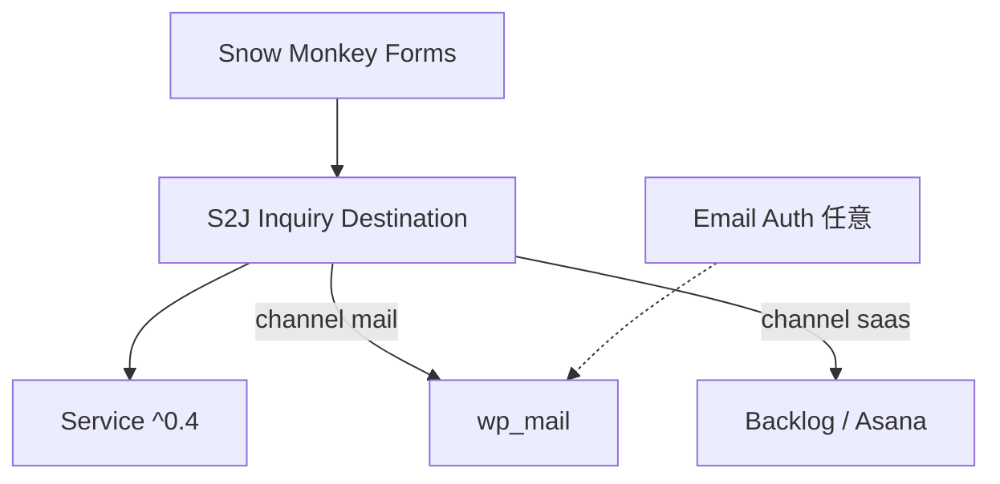

# S2J Inquiry Destination - リリース実装仕様 (v0.2)

**状態:** spec **確定** (2026-10-27) — [`docs/`](../../) にマージ済。CHANGELOG / タグ **`v0.2.0`** はコード完了後 ([modification.md](./modification.md))。

**起点バージョン:** プラグイン **0.1.1** (MailerHook / `wp_mail_failed`)。Service **^0.4.0** (**`docs/` 正本** — [transport_boundary_spec.md](https://github.com/stein2nd/s2j-inquiry-destination-service/blob/main/docs/core/transport_boundary_spec.md))。

**Companion:** Service v0.4.0と **同時リリース推奨** (公開 API breaking change なし)。

---

## 1. 目的 (Why)

1. **Mail チャネル** で DKIM/SPF/DMARC を **`Email Auth`** + `wp_mail` (Transport) に委譲する方針を、プラグイン spec として固定する (D-013– D-015)。
2. **SaaS チャネル** は API 秘密・接続・種別プロジェクトを本プラグインが保持 (D-009– D-012、変更なし)。
3. **SMF 写像・種別** は Mail / SaaS 共通 SoT (変更なし)。

## 2. スコープ (What)

### 2.1. 含める

| 領域 | 正本 (起草) | 確定後 `docs/` |
| --- | --- | --- |
| Mail / Transport | [mail_deliverability_spec.md](./mail_deliverability_spec.md) | `mail_deliverability_spec.md` **新規** |
| Runner ヘッダー | [dispatch_execution_spec.md](./dispatch_execution_spec.md) § Mail | 同名マージ |
| 決定事項 | [decisions.md](./decisions.md) D-013– D-015 | `decisions.md` マージ |
| 統合・索引 | [plugin_spec.md](./plugin_spec.md)、[overview.md](./overview.md)、[specs.md](./specs.md) | 同名マージ |
| 管理 UI | [admin_ui_spec.md](../../admin_ui_spec.md) §メール認証案内 | **反映済** (レビューのみ) |
| 依存 | `composer.json` → **`^0.4.0`** | 同左 |
| 実装 | `Runner::executeMail` — `From:` 削除 | `includes/Dispatch/Runner.php` |
| 品質 | [status.md](./status.md)、[test-results.md](./test-results.md) | `docs/status.md` 等 |

### 2.2. 含めない

[mail_deliverability_spec.md](./mail_deliverability_spec.md) §1、[plugin_spec.md](./plugin_spec.md) §非目標を正本とする。要約: 本プラグイン内 DKIM、**`Email Auth` 必須化**、GatherPress 型 UI 統合、SaaS 新 `kind`、CC/BCC/HTML Mail。

## 3. 設計 (How)

### 3.1. レイヤー

| データ | Mail | SaaS |
| --- | --- | --- |
| 写像・種別 | `s2j_inquiry_destination_forms` / `types` | 同左 |
| 接続・秘密 | なし (D-010) | `s2j_inquiry_destination_saas` |
| 計算 | Service の4関数 | 同左 |
| 副作用 | `wp_mail` | `wp_remote_request` |

### 3.2. 実装タスク (コード)

| # | タスク | 参照 | 状態 |
| --- | --- | --- | --- |
| 1 | タブ1 `Email Auth` notice | [mail_deliverability_spec.md](./mail_deliverability_spec.md) §6 | **済** |
| 2 | Runner `$headers` から `From:` 削除 | [dispatch_execution_spec.md](./dispatch_execution_spec.md)、D-015 | 未 |
| 3 | `composer.json` / lock **^0.4.0** | [plugin_spec.md](./plugin_spec.md) | 未 |
| 4 | README に1行 (`Email Auth` 推奨) | [release_v0.2_spec.md](./release_v0.2_spec.md) §4 | 未 |

### 3.3. Service 連携

* MailMaterial **4キーのみ** (Service v0.4)。
* `kind` / Runner 分岐: D-011 / D-012 **変更なし**。

## 4. バージョン・配布

| 項目 | v0.2.0 |
| --- | --- |
| プラグイン semver | **0.2.0** |
| Service (Composer) | **`^0.4.0`** |
| dist zip | タグ `v0.2.0` → [dist-zip.yml](../.github/workflows/dist-zip.yml) |
| CHANGELOG | Added: mail deliverability、`Email Auth` 案内、Runner From (D-015) |

## 5. 完了条件

[status.md](./status.md) 100% + [test-results.md](./test-results.md) Pass 記録。

最低限:

1. `docs_mod/` ミラーを `docs/` にマージ (新規は `mail_deliverability_spec.md` のみ)。
2. タスク §3.2の #2– #3。
3. 手動 §7.1 ([mail_deliverability_spec.md](./mail_deliverability_spec.md))。
4. `npm run lint:docs` / CI green。

## 6. 関連ドキュメント (起草セット)

| 種別 | ファイル |
| --- | --- |
| リリース統括 | 本ファイル |
| ミラー spec | [mail_deliverability_spec.md](./mail_deliverability_spec.md)、[dispatch_execution_spec.md](./dispatch_execution_spec.md)、[decisions.md](./decisions.md)、[plugin_spec.md](./plugin_spec.md)、[overview.md](./overview.md)、[specs.md](./specs.md) |
| 証跡 | [modification.md](./modification.md)、[status.md](./status.md)、[test-results.md](./test-results.md) |
| Service | [transport_boundary_spec.md](https://github.com/stein2nd/s2j-inquiry-destination-service/blob/main/docs/core/transport_boundary_spec.md) |
