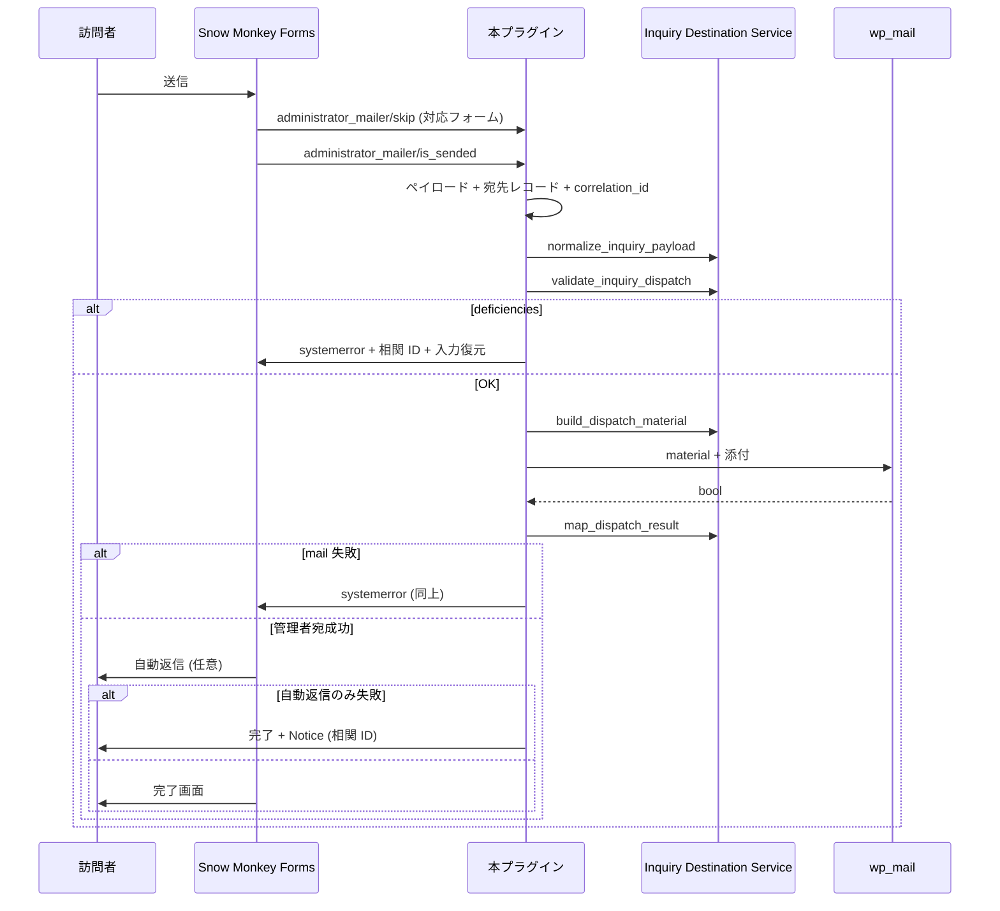

# S2J Inquiry Destination - コンセプト

## 背景

MW WP Form の保守停止を受け、Snow Monkey Forms に移行する一方、問い合わせ内容を WordPress に蓄積したくない、という要件があります。**Mail** は `wp_mail`、**SaaS** は [Inquiry Destination Service ^0.3](https://github.com/stein2nd/s2j-inquiry-destination-service) 経由で **Backlog 課題 / Asana タスク** 起票 ([saas_connection_spec.md](./saas_connection_spec.md))。

## ユースケース

1. 運営者が **設定 > S2J Inquiry Destination** で dispatch チャネル (mail / SaaS)、種別と宛先、SMF 写像を設定する ([admin_ui_spec.md](./admin_ui_spec.md))。
2. 各 SMF フォームを種別に対応付け、コントロール name を氏名・メール等にマップする。
3. 訪問者がフォーム送信 → 本プラグインが Service + **Mail または HTTP** で届ける → 成功後 SMF が自動返信 (設定時)。
4. 失敗時は、完了画面に進まず、SMF が responser 値で入力欄を復元する ([dispatch_execution_spec.md](./dispatch_execution_spec.md))。

## 処理フロー (プラグイン視点)

正本の呼び出し順は [dispatch_execution_spec.md](./dispatch_execution_spec.md) です (本図は概要)。

## 関連

* Service 側フロー: [Service concept.md](https://github.com/stein2nd/s2j-inquiry-destination-service/blob/main/docs/concept.md)
* 送信詳細: [dispatch_execution_spec.md](./dispatch_execution_spec.md)
* 決定事項: [decisions.md](./decisions.md)
