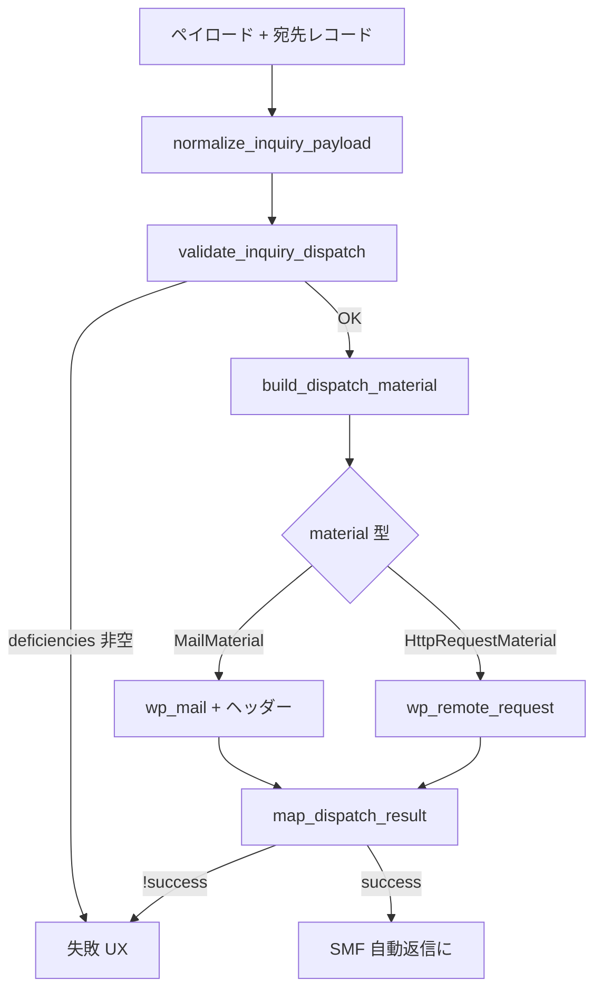

# S2J Inquiry Destination - 送信実行

## 設計意図

1回のフォーム完了につき **Dispatch Runner** が Service 公開4関数を順に呼び、副作用 (**`wp_mail` または HTTP**) を **Runner の1箇所** で起こします。規則の正本は [Inquiry Destination Service](https://github.com/stein2nd/s2j-inquiry-destination-service/blob/main/docs/specs.md) です。

Runner は **Mail** と **SaaS HTTP** の双方を実装します ([status.md](./status.md)、D-012)。Service **^0.4.0** (Mail 材料4キー、SaaS 節) を前提とします。

Mail の Transport (DKIM/SPF/DMARC) は Service 外です ([Service transport_boundary_spec.md](https://github.com/stein2nd/s2j-inquiry-destination-service/blob/main/docs/core/transport_boundary_spec.md)、[mail_deliverability_spec.md](./mail_deliverability_spec.md))。

## 呼び出し順 (共通)

正本: [usage_spec (Service)](https://github.com/stein2nd/s2j-inquiry-destination-service/blob/main/docs/interfaces/usage_spec.md)。

| 段 | 実施者 | 備考 |
| --- | --- | --- |
| 正規化・検証・材料 | Service | 不足コードは [validation_spec (Service)](https://github.com/stein2nd/s2j-inquiry-destination-service/blob/main/docs/core/validation_spec.md) のみ正本 |
| 実行 | 本プラグイン | Mail: Reply-To / 添付 (From は D-015)。SaaS: timeout、decode のみ (秘密は材料にのみ) |
| 結果写像 | Service | `context['correlation_id']` を渡す |

## 宛先レコードの組立 (プラグイン)

1送信 = 1レコード。キーは **すべて** 渡します ([Service destination_spec](https://github.com/stein2nd/s2j-inquiry-destination-service/blob/main/docs/core/destination_spec.md))。

`kind` の決定: [saas_connection_spec.md](./saas_connection_spec.md)、D-011。

| キー | `channel=mail` | `channel=saas` + Backlog | `channel=saas` + Asana |
| --- | --- | --- | --- |
| `kind` | `mail` | `saas_backlog` | `saas_asana` |
| `inquiry_type` | ペイロードと同一 | 同左 | 同左 |
| `mail_to` | `TypeRow.mail_to` | `[]` | `[]` |
| `saas_endpoint` | `''` | タブ1 `endpoint` | タブ1 (空可) |
| `saas_project_id` | `''` | `TypeRow.saas_project_id` | `TypeRow.saas_project_id` |
| `credentials` | `[]` | `api_key` (サイト) + `issue_type_id` / `priority_id` (種別) | `access_token` (サイト) |

## correlation_id

* 生成: 試行開始時に1回 ([data_dictionary.md](./data_dictionary.md))
* `map_dispatch_result( $kind, $outcome, [ 'inquiry_type' => …, 'correlation_id' => … ] )`

## Mail 実行 (`wp_mail`)

件名の表示文言は `subject_hint` (= 種別 `label`) を載せ、Service [mail_adapter_spec](https://github.com/stein2nd/s2j-inquiry-destination-service/blob/main/docs/core/mail_adapter_spec.md) が組み立てます。材料キーは **`to` / `subject` / `body` / `content_type` の4つのみ** です (v0.4)。

| 項目 | 規則 | 実装 (v0.2) |
| --- | --- | --- |
| To / Subject / Body | `material['to']` / `material['subject']` / `material['body']` | 変更なし |
| Content-Type | `sprintf( 'Content-Type: %s; charset=UTF-8', $material['content_type'] )` | `Runner::executeMail` |
| **From** | **`$headers` に `From:` 行を載せない** (D-015) | `wp_mail_from` / `wp_mail_from_name`。`Email Auth` 有効時は同プラグインが上書きし得る |
| **Reply-To** | ペイロード `email` が `is_email()` の場合、**`Reply-To: {email}`** | 空・無効時はヘッダー行なし |
| 添付 | SMF 一時ファイル (Service 材料外) | 変更なし |
| 成功 | `wp_mail === true` | 変更なし |
| CC / BCC | なし | 変更なし |

**v0.1.1までの実装:** `From: {admin_email}` を `$headers` に直書きしていた。v0.2で D-015に従い削除する。

問い合わせ以外の `wp_mail` (パスワードリセット、SMF 自動返信) は本プラグインの Runner を経由しません。`MailerHook` は D-005どおり `wp_mail_failed` のみ監視し、`Email Auth` と共存します。

## SaaS 実行 (`wp_remote_request`)

Service ^0.4、[usage_spec §SaaS](https://github.com/stein2nd/s2j-inquiry-destination-service/blob/main/docs/interfaces/usage_spec.md) と同型です。

1. `build_dispatch_material` の `material` が **HttpRequestMaterial** (`method`, `url`, `headers`, `body`)。
2. `wp_remote_request( $url, [ 'method' => …, 'headers' => …, 'body' => …, 'timeout' => 30 ] )`。
3. `http_status`: レスポンスコード。`WP_Error` 時は **`0`**。
4. `parsed_body`: `json_decode( body, true )`。**array でない場合、`[]`**。
5. `map_dispatch_result( 'saas_backlog' | 'saas_asana', [ 'http_status' => …, 'parsed_body' => … ], $context )`。

| 禁止 | 理由 |
| --- | --- |
| レスポンス body の `error_log` | PII / 秘密の恐れ ([Service service_spec](https://github.com/stein2nd/s2j-inquiry-destination-service/blob/main/docs/service_spec.md)) |
| Backlog `apiKey` クエリー | ヘッダー `Backlog-API-Key` のみ |

成功時、結果の `external_ticket_id` が空でないことを **完了画面の前提** とします (Service: HTTP **201** + id / gid — [result_spec (Service)](https://github.com/stein2nd/s2j-inquiry-destination-service/blob/main/docs/core/result_spec.md))。

Mail 専用の Reply-To / 添付は **SaaS 経路では送りません** (ペイロードは Service が課題 / タスク本文に写す)。

## 失敗 UX (管理者宛)

下記のいずれかで **完了画面に進めない**:

* `validate_inquiry_dispatch` の `deficiencies` が非空
* Mail: `wp_mail` が `false` → `mail_rejected`
* SaaS: `map_dispatch_result` の `success` が false (`saas_http_error` / `saas_body_invalid` 等)

処理:

1. SMF **systemerror** (`RuntimeException` — [snow_monkey_forms_spec.md](./snow_monkey_forms_spec.md))
2. 訪問者: 汎用エラー + **相関 ID**。deficiency / failure_code 文字列は出さない
3. 入力欄は SMF responser 復元
4. [logging_spec.md](./logging_spec.md) に1行

## 成功後: 自動返信

* 管理者宛 Runner 成功 **後**、SMF `AutoReplyMailer` (文面は SMF)
* **自動返信だけ失敗**: D-005 ([decisions.md](./decisions.md)) — 完了維持 + Notice + `autoreply_failed` ログ

## 再送・キュー

再送キュー、失敗本文の永続化、管理画面の再送: **なし**。

## 関連

* Mail 配送・認証: [mail_deliverability_spec.md](./mail_deliverability_spec.md)
* SaaS 接続: [saas_connection_spec.md](./saas_connection_spec.md)
* SMF フック: [snow_monkey_forms_spec.md](./snow_monkey_forms_spec.md)
* ログ: [logging_spec.md](./logging_spec.md)
