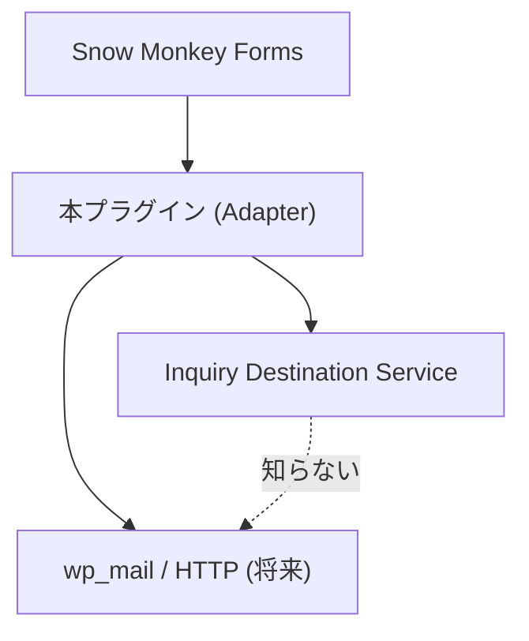

# S2J Inquiry Destination - 設計原則

## 設計意図

WordPress フックと I/O を外枠に閉じ、問い合わせの **ルールと文面組立** は Service の純関数に任せます (Webinar / Slug Generater 同型)。

## 依存の向き

* Service は、WordPress、SMF、`wp_mail` を import しない。
* 本プラグインは、Service の公開4関数のみを入口に使う。**呼び出しは `Dispatch\Runner` のみ** ([decisions.md](./decisions.md) D-001、[architecture.md](./architecture.md))。

## Source of Truth

| 対象 | 正本 |
| --- | --- |
| 不足コード、Mail 本文行順、結果レコードの PII (個人を識別できる情報) 境界 | Service `docs/core/` |
| option キー、画面ラベル、SMF フック名、From/Reply-To | 本プラグイン `docs/` |
| `correlation_id` 生成 | 本プラグイン ([logging_spec.md](./logging_spec.md)) |

## Composer

* `composer.json` の `require` は、**`s2j/inquiry-destination-service`** のみ (Packagist)。Mail **^0.2**、SaaS (Backlog / Asana) **^0.3.0** ([saas_connection_spec.md](./saas_connection_spec.md))。
* `repositories` に `path` / `VCS` を書かない ([plugin_spec.md](./plugin_spec.md))。
* 不足コード / `failure_code` / HTTP 材料の正本は **Service `docs/`** — プラグイン docs に複製しない ([dispatch_execution_spec.md](./dispatch_execution_spec.md))。

## 成功と UX

* **成功と分かるまで** 完了画面・受け付け完了表示を出さない ([Service service_spec](https://github.com/stein2nd/s2j-inquiry-destination-service/blob/main/docs/service_spec.md))。
* 管理者宛の成功後の **自動返信の失敗** は、成功扱いのまま ([dispatch_execution_spec.md](./dispatch_execution_spec.md))。
* 再送キューは持たない。

## 関連

* ガバナンス: [governance/documentation_governance.md](./governance/documentation_governance.md)
